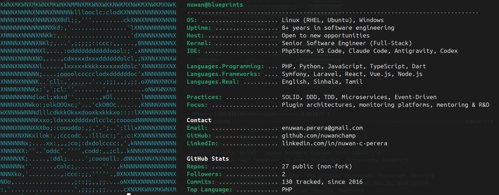

## Case Studies

| Case Study | What it shows | Impact |
|---|---|---|
| [Plugin Framework Architecture](case-studies/01-plugin-framework-architecture) | Event-driven plugin/micro-frontend framework for an enterprise Symfony monitoring platform | 40% faster release cycles, 10+ features centralized |
| [Kids' ICT Game: Mouse & Keyboard Skills](case-studies/03-kids-ict-game-adaptive-pedagogy) | Gamified computer-skills training for children with special educational needs in Sri Lanka: no-fail difficulty, audio-first, teacher-editable content | 20 levels, 2 practice modes; in active use by 5-7 students at Rainbow Roots Academy |

<!-- Todo More case studies (VoIP monitoring at scale, event-driven subnet scanning, clean architecture & TDD in Laravel) are in progress.
-->
## Skills

| Category | Key Items |
|---|---|
| Languages & Frameworks | PHP, Symfony, Laravel, Python, React, Vue.js, Node.js, TypeScript, Dart |
| DevOps & Cloud | Docker, CI/CD, Linux, AWS, GCP, Azure, Git, Shell Scripting |
| Testing | PHPUnit, Pest, Cypress, Selenium, Laravel Dusk |
| Architecture & Principles | SOLID, DDD, TDD, Microservices, Design Patterns, Clean Code |
| Soft Skills | Mentoring, Communication, Team Leadership, Technical Writing |

## Contact

- GitHub: [github.com/nuwanchamp](https://github.com/nuwanchamp)
- LinkedIn: [linkedin.com/in/nuwan-c-perera](https://www.linkedin.com/in/nuwan-c-perera)
- Email: enuwan.perera@gmail.com
