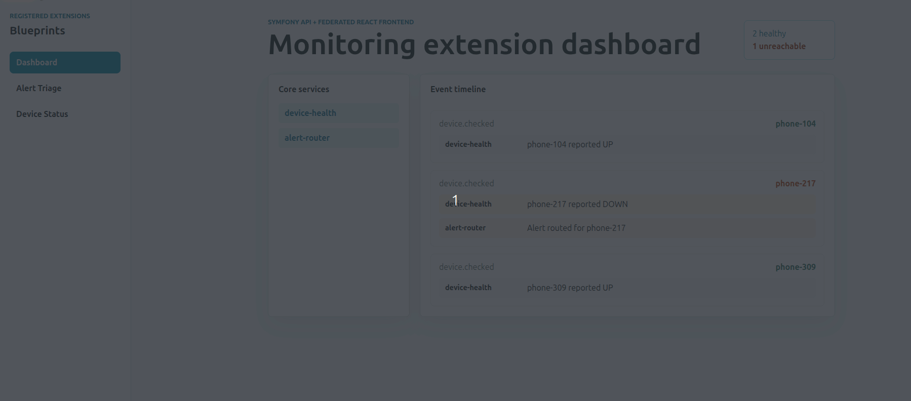

# Plugin Framework Architecture

Led the architecture direction for a plugin framework that reduced release coupling in a Symfony 5 enterprise monitoring platform and improved release-cycle speed by more than **40%**.

**Role:** Senior Software Engineer  
**Domain:** Enterprise monitoring platform  
**Period:** June 2025 - May 2026

## Challenge / Task

The initial task was to bring a legacy CLI-based network scanner into the platform's plugin system. While working through that integration, I found a deeper architectural problem: the existing plugin model had grown decentralized and difficult to maintain.

The platform used a Symfony backend with a React frontend, but plugins were not integrated through a clear extension model. Some plugin UIs were embedded through iframes, plugin repositories were run separately on the host server with long-running background processes, and backend plugin logic was often implemented directly inside the core application behind activation flags.

What started as a scanner integration exposed accumulated technical debt in the plugin architecture. The real challenge became designing a centralized, maintainable plugin framework without rewriting the platform.

Key problems to resolve:

- Plugin behavior was scattered across separate repositories, iframes, host-level processes, and core application code.
- Backend plugin logic polluted the core system, including code paths for plugins that were not always active or used.
- Core application changes increased regression risk across unrelated features.
- Frontend and backend feature delivery were tightly coupled to the main application.
- Plugin maintenance carried high cognitive load because ownership and runtime boundaries were unclear.
- The platform needed a path to support more feature modules without turning the core into a larger monolith.

## What I Did

- Researched the existing plugin implementation while delivering plugin-related work.
- Identified that the scanner integration problem was part of a broader plugin architecture issue.
- Discussed the technical debt and long-term direction with stakeholders.
- Helped align the team around a centralized plugin framework instead of continuing the iframe and hardcoded-core approach.
- Headed the architectural direction for a plugin-based framework within the existing monitoring platform.
- Guided implementation across backend extension boundaries and frontend micro-frontend boundaries.
- Helped move feature work out of the central application path and into independently owned plugin modules.
- Mentored engineers on modular architecture, clean boundaries, and reducing cross-feature coupling.

## Architecture

The framework separated the platform into a thin core and feature plugins. The core remained responsible for shared platform concerns, while plugins owned their feature-specific backend behavior and UI.

```
        +------------------+       registry/contracts      +----------------------+
        |   Core Platform  | <---------------------------> |  Feature Plugins     |
        |                  |                              |                      |
        | shared services  |                              | backend extensions   |
        | plugin registry  |                              | frontend remotes     |
        | host shell/theme |                              | feature workflows    |
        +------------------+                              +----------------------+
```

Production used a plugin framework with micro-frontend and microservice-oriented boundaries. The core idea was that plugin features registered into the platform instead of being hardcoded into the central application. The platform shell owned shared concerns such as navigation, authentication context, runtime contracts, and visual consistency; plugins owned their feature-specific UI, APIs, and workflows.

## Key Decisions & Tradeoffs

- **Centralized plugin model over scattered runtime behavior** - plugin discovery, ownership, and integration moved toward a consistent framework instead of ad hoc iframes, host processes, and core flags.
- **Plugin boundaries over core growth** - feature capabilities moved behind extension boundaries instead of continuously expanding the main application.
- **Contracts/events over direct coupling** - plugins integrated through defined boundaries so unrelated features did not need to call into each other directly.
- **Micro-frontends for UI delivery** - plugin UI could evolve independently from the main React shell.
- **Shared platform layer over private host imports** - plugins consumed stable shared contracts for runtime packages, UI primitives, and theme tokens instead of reaching into host internals.
- **Accepted some indirection** - the architecture made some flows less direct to trace, but reduced regression risk and release coordination overhead.

## Impact

- Centralized **10+ features** under one extensible framework.
- Improved release cycle speed by more than **40%**.
- Reduced the need for unrelated feature teams to coordinate around shared core application changes.
- Lowered maintenance risk by moving plugin specific behavior out of polluted core paths.
- Created a clearer path for adding future platform capabilities without rewriting the core.

## Tech Stack

PHP, Symfony 5, React.js, TypeScript, micro frontends, microservices, event driven architecture, RHEL/Linux.

## Clean-Room Demo



[`demo/`](./demo) is an original clean-room sample written for this portfolio : not proprietary production code, and intentionally simplified from the exact versions and boundaries used in production (the production system used micro frontend and microservice-oriented plugin boundaries; this demo keeps backend extensions inside the same Symfony app so reviewers can see the registration pattern without standing up isolated services).

It registers two plugins (`Device Status`, `Alert Triage`) dynamically from a SQLite backed registry, loaded into the React host at runtime via module federation — the same registration over hardcoding pattern described above, in miniature. Start with [`demo/src/Extension/ExtensionRegistry.php`](demo/src/Extension/ExtensionRegistry.php) for the plugin contract itself.

See [`demo/README.md`](./demo) for prerequisites, run instructions, a request flow diagram, and a full code tour.

## Lessons Learned
Refactoring is a valuable part of software development. Rethinking existing implementations often leads to better solutions. I enjoyed improving the code structure to make it cleaner, easier to understand, and more maintainable, enabling junior plugin developers to work with greater confidence and fewer obstacles.