# Kids' ICT Game: Mouse & Keyboard Skills

> Phase one of a technology education programme for children with special educational needs in Sri Lanka: a Godot 4 desktop game that teaches the mouse and then the keyboard through 20 short levels and two replayable practice modes, built so a child can never fail and a grown up can retune content without a rebuild.

**Type:** Concept-driven product for a special-needs education initiative in Sri Lanka (shipped as a Windows desktop build named "Fun Labs")
**Institution:** Rainbow Roots Academy
**Role:** Developer and designer of the concept games
**Period:** July to August 2026 (from the project's commit history)

| Choose a unit | Mouse module: Corner Homes | Keyboard module: Word Builder |
|---|---|---|
| 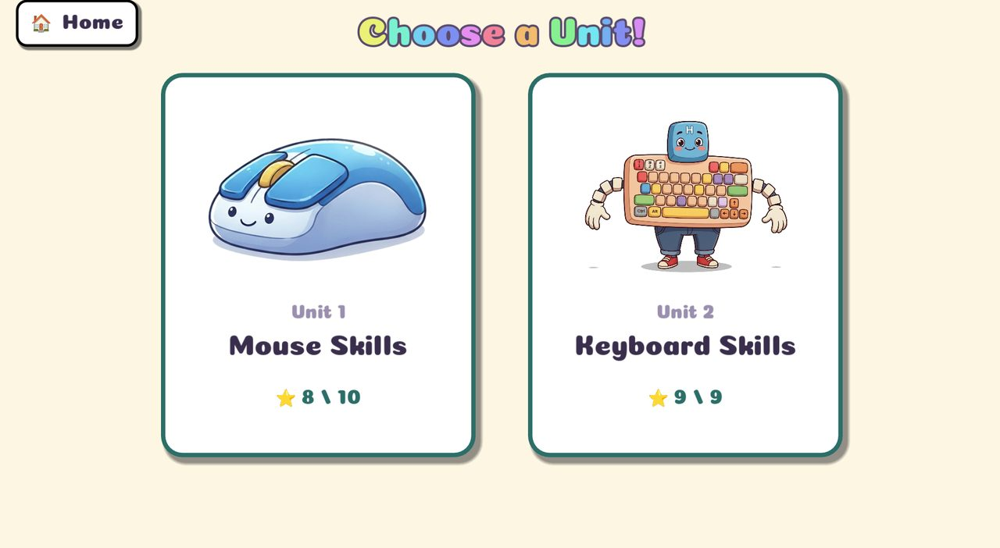 | 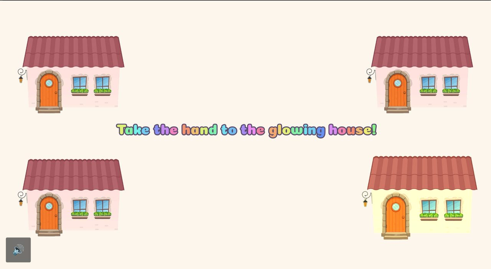 | 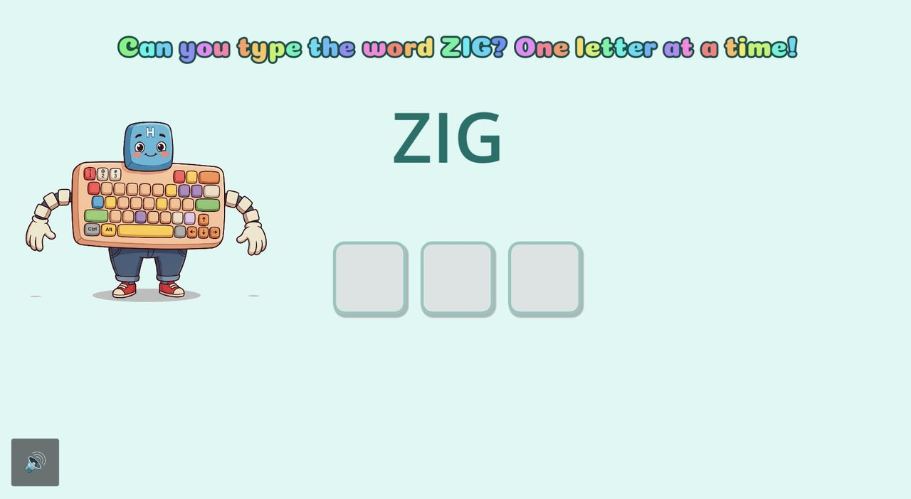 |

*More screens in the [gallery](#gallery) below.*

## Problem / Context

The project grew from the concept of a special needs education teacher committed to the
well being of children who need specialised care in education. Technology based learning is rare
in Sri Lanka's special needs sector. The long term vision is to train these children in career
skills they can live on as adults. The stepping stone, and the scope of this phase, is
comfortable use of computers and electronic devices so they grow alongside technology. Two fun,interactive modules were built for it `mouse skills and keyboard skills`.

A child who has never held a mouse has to learn point, click, double click and drag, then
letters, arrows, Shift and Enter. Ordinary software punishes mistakes and assumes reading, so the
design constraints were no fail states, audio first narration, no reading required, and content
a grown up (the teacher) can adjust on an already shipped copy.

## Design Process

Each unit started as a written level plan before any code, so the pedagogy was reviewable by the
teacher and not buried in scripts. The plans (Mouse, Keyboard, Speed Practice, and a drafted Browser unit) share one template , overview, global rules, a level summary table, per level
setup/ narration/ forgiveness/ success/ ends, and an "open decisions" list.

- **Curriculum aligned.** The plans target Grade 2 ICT skills outcomes. The final star chart is
  styled after the "Evaluation" checklist page in the pupil's book ("I can move the mouse ✓ … I can click ✓ … I can drag ✓"), so a teacher sees at a glance which skills each child has practised.
- **Skills ordered by how motor control develops.** 
	- **Mouse**:  cursor follows my hand, big movements,  controlled movement, single click, click and aim, tracking, double click, drag and drop.
	- **Keyboard**: any key does something, the one big key (Space), a named key, arrows, Enter, letter sequences, timed matching, Shift combos, typing and correcting a word.
- **Eight global rules applied to every level** 
	- audio first narration with at most one short line of text. an 8 second idle hint where the mascot demonstrates the action (a ghost cursor in Unit 1, a ghost key press in Unit 2) no fail states, and no timers until the boss level. An   instant sound and animation on every success, a speaker icon to repeat the instruction about   2 - 3 minutes per level. subtly harder targets each round; and a picture-based menu that needs no  reading.
- **Plans evolved as they were built.** 
	- The Mouse plan listed nine levels and the game has ten  a  "Pop the Balloons" level was added, and mascot specific levels changed ("Poke Pip" became "Poke  the Kitty", the drafted "Steer Pip" became "Steer the Bunny"). The first plan also recommended a  web app but the project was built in Godot instead as this meant to be guided by a professionals

## Approach & Architecture

- **Level scripts are self contained and procedural.** Most UI (tiles, cards, results screens,
  the on screen keyboard) is built in code, so levels share a visual language without a shared
  scene hierarchy. Roughly 11.8k lines of GDScript across 38 scenes.
- **One global `StarChart` autoload** owns progress. Levels call a single `add_star(n)`. it handles
  the chime, the fly to slot animation, the persisted save file, and per unit counts for results.
- **Level menu is data driven**: one script serves both units from a table of
  `{scene, level_number, title}` every level is always open (no locking).
- **Replayable practice modes** (Speed Round, Word Train) reuse the curriculum mechanics but award no stars, so they can be repeated freely.

## Key Decisions & Tradeoffs

- **No fail states, only coaching.** A wrong key gets a nudge ("Hold Shift first, then the
  letter"), a missed falling letter just poofs. The cost is that difficulty must come from
  somewhere else, hence the next two points.
- **Hidden difficulty ramp.** Targets shrink or sit closer together across rounds (the corner
  houses get smaller each of three rounds, bubbles shrink and speed up, look alike neighbour
  letters like E/R and I/O appear only in the last round), so precision is trained without the
  child seeing a "harder" label.
- **Fixing a coverage gap with data.** Auditing which letters the ten keyboard levels actually drill
  showed lopsided coverage: top row 8 of 10 keys, home row only 4 of 9, bottom row 3 of 7, with Q, Y, F, G, H, J, L, Z, X, C and V never appearing. Rather than lengthening the curriculum, the  planned fix was a separate, replayable, star free practice mode dealing from a shuffled A-Z
  "bag", so every letter gets even turns and none repeats back to back. It ends with a personal
  best, never a loss. **Open question from the plan**: whether to show letters per minute or a raw count  to young readers.
- **Mercy mechanic on the boss levels.** After two misses the next few letters fall at a gentle
  fixed speed, then the ramp resumes. Keeps the boss level exciting but never frustrating.
- **Audio first narration with text mirrored on screen.** Recorded voice clips drive each level
  dynamic lines (a specific letter or count) can't be pre recorded, so they stay text plus chime.
  Mixed clips and text is a pragmatic compromise, and some screens are still text only.
- **Content as editable files, with an override beside the executable.** Words and round lengths
  live in `.tsv`/`.cfg`; a copy next to the shipped `.exe` wins immediately, so a grown up can tune  difficulty without a rebuild. Values are validated and clamped, and a built in fallback word  bank means a bad edit can't break the mode.
- **Generous input rules over OS defaults.** For instance, Open Sesame uses its own 0.7 s
  double click window instead of the OS setting.
- **Procedural keyboard glyphs in the default font** so letters match the child's physical
  keyboard, rather than baking letters into mascot art.
- **A rule that lets teachers retune it.** Round lengths and word lists live in plain files,  because the right length for young attention spans was an open question in the plan (60 seconds
  was a starting guess), not something to hard code.
- **Cost of the self contained script style:** shared patterns (idle hint, `_say`, cursor setup,
  mercy tuning) are repeated across level files instead of living in a base class. That kept each
  level easy to prototype and test alone, but it is the first thing I'd refactor now.

## Measured Impact

- **In active use:** currently 5-7 students at Rainbow Roots Academy practise with the system, and
  they engage with it happily (teachers feedback)
- **Delivered:** 20 levels in two units, two replayable practice modes, and a Windows build
  exported from the project.
- **Not yet measured:** no learning outcome data (skill progression, session counts) has been
  collected. <!-- TODO: add progress data  -->

## Gallery

Real screens from the running game (play through captures, no pupil names or photos appear).

**Branding and menus**

| Academy splash                                                              | Loading screen                                                              | Unit select                                                   |
| --------------------------------------------------------------------------- | --------------------------------------------------------------------------- | ------------------------------------------------------------- |
| 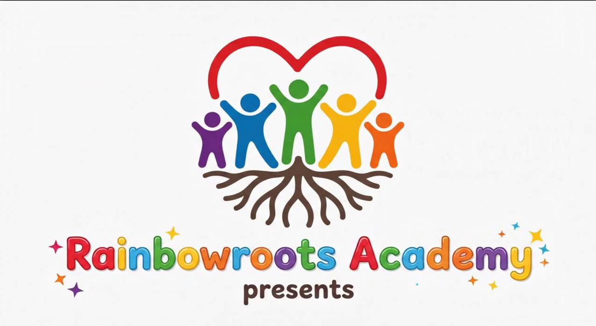 | 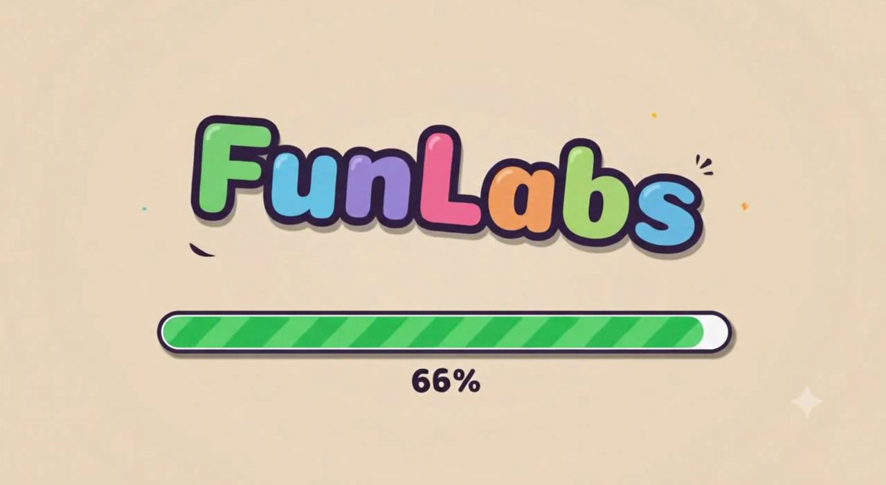 |  |

**Unit 1: Mouse Skills.** Each screen shows one line of rainbow text (also narrated) and a speaker
button to hear it again.

| Unit intro | Pop the Balloons | Corner Homes |
|---|---|---|
| 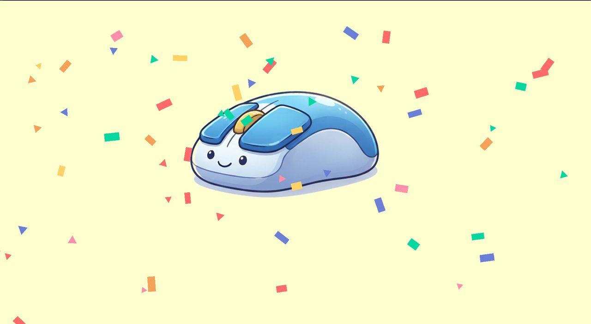 | 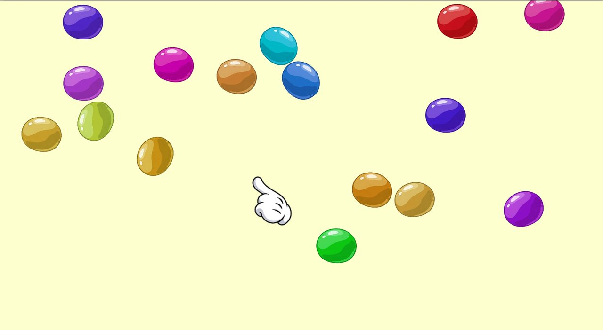 |  |
| **Follow the Trail** | **Poke the Kitty** | **Bubble Pop Party** |
| 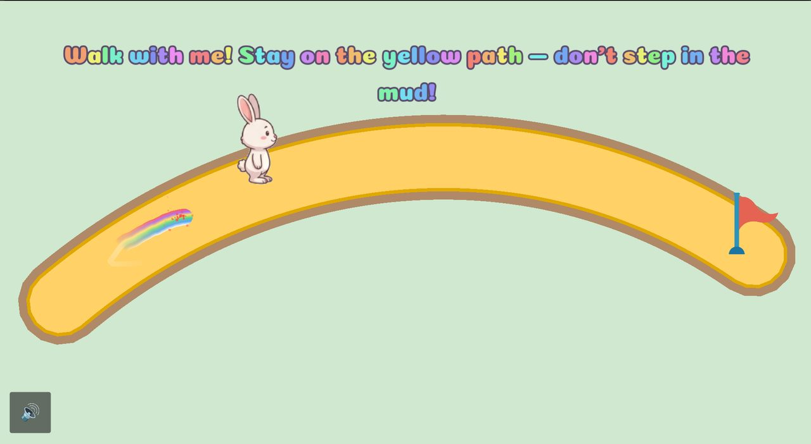 | 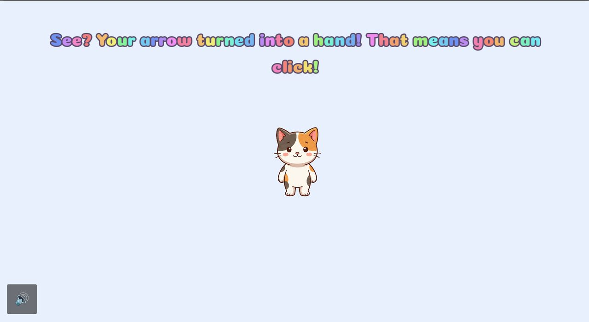 | 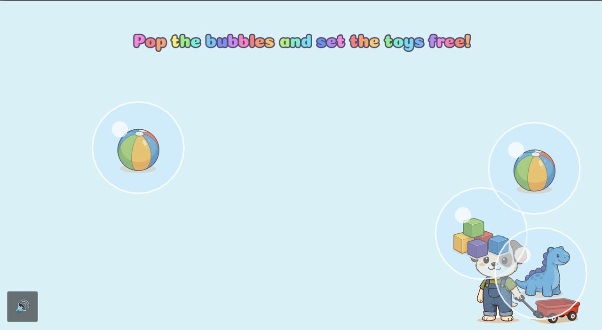 |
| **Catch Me If You Can** | **Open Sesame** | **Tidy Up with Pip** |
| 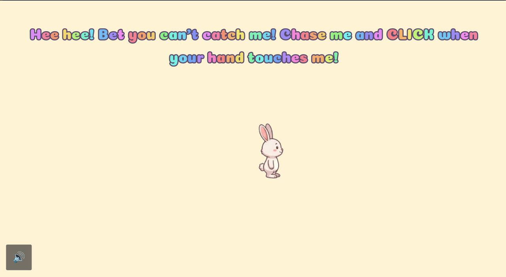 | 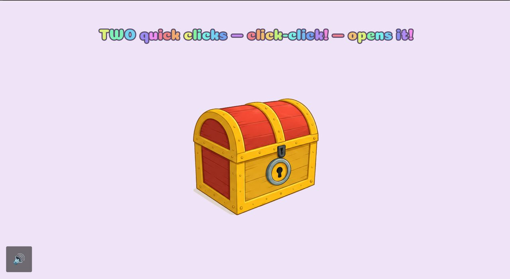 | 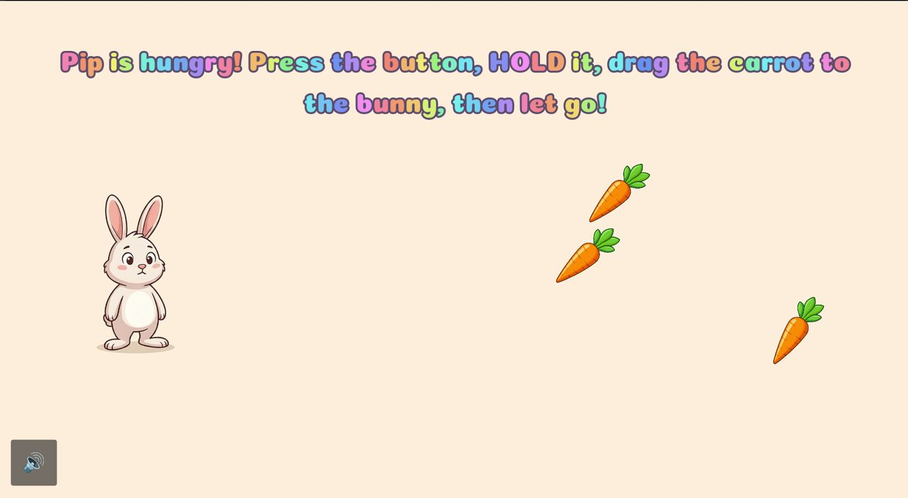 |

**Unit 2: Keyboard Skills.** The on-screen keys use the plain system font so the letters match the
child's physical keyboard.

| Space Jump | Find the Letter | Letter Parade |
|---|---|---|
| 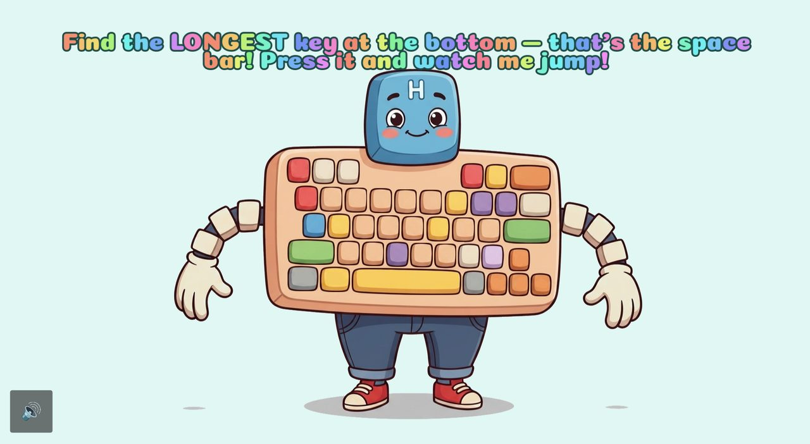 | 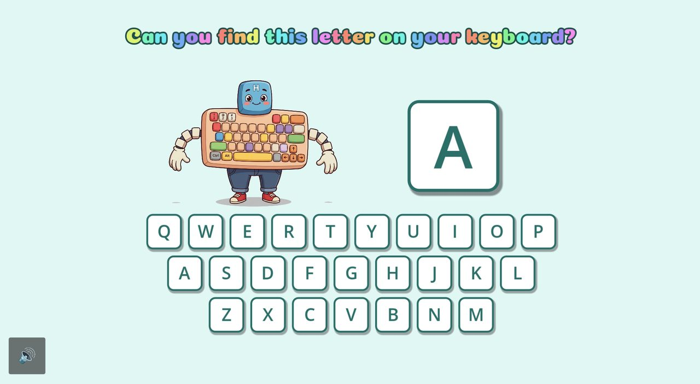 | 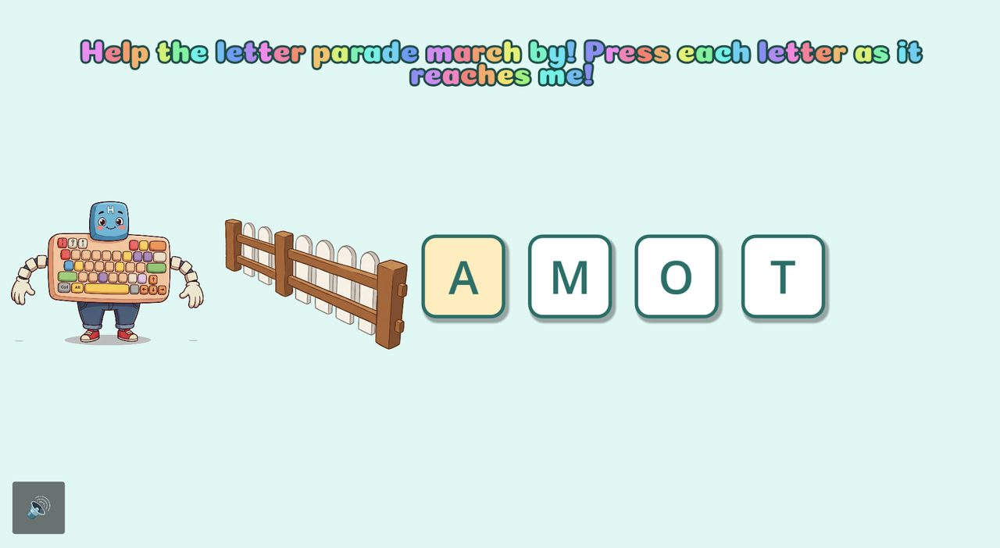 |
| **Big Letters** | **Word Builder** | |
| 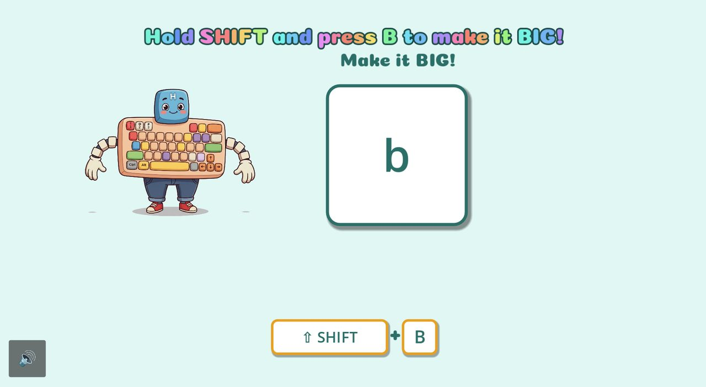 |  | |

## Roadmap

Drafted but not built yet :

- **Unit 3: Browser Skills with "Nav".** Ten levels (address bar, typing an address, links,
  Back/Forward, scrolling, tabs, closing a pop up, refresh) practised inside a fully simulated
  browser built from game UI, so nothing in levels 1-9 touches the internet. Level 10 opens one
  pre approved real page in an embedded view. The plan flags the real web view as the first native  plugin in an otherwise pure GDScript project and notes it has no built in child safety, so link clicks and pop ups would be intercepted and redirected back into the game.
- **Simpler games for students who need them.** Based on classroom observation, add easier,
  more stripped down activities alongside the current levels.
- **Narration and languages.** The plans leave open whether to add Sinhala and Tamil audio
  alongside English, and ask for a mascot name that is easy to say in all three. Levels without a
  recording currently run text only.
- **Physical keyboards.** Whether lab keyboards need letter stickers or an overlay for younger
  pupils is noted as an open decision.

## Tech Stack

Godot 4.7 (GDScript, GL Compatibility renderer, Jolt physics enabled), custom canvas item hue shift shader, procedurally generated audio chimes, recorded voice narration, `ConfigFile`/TSV for data, Windows desktop export. The sample tooling is Python (standard library) plus ffmpeg.

AI Generated content: Some part of game assets are generated using freely available AI tools

## Try It

[`game/`](./game/README.md) is the full Godot 4 project (scenes, scripts, data files) with a setup guide. The original art, narration and videos stay with Rainbow Roots Academy, so a generator creates stand in media and the whole game plays with them. Start with [`game/Scripts/star_chart.gd`](./game/Scripts/star_chart.gd) for the global progress system, or [`game/Scripts/unit_2_level8.gd`](./game/Scripts/unit_2_level8.gd) for a complete level with the hidden ramp and mercy mechanic.

<!-- TODO: Add standalone demo of the learnin -engine patterns  -->

## Lessons Learned

These come from observing several students using the system at Rainbow Roots Academy.

- **The audience is wider than the curriculum it was written against.** The level plans target
  Grade 2 ICT outcomes, but the students who ended up using it are above Grade 2. Matching the   syllabus level did not mean matching the learner ability, not grade, decides who can use which  level.
- **Some students need simpler games.** A single difficulty ladder (even a gentle, hidden one)
  does not cover everyone. Some students need specialised, more stripped down games, so the next  step is easier entry points, not only more levels.
- **The software cannot teach the skill alone.** It works as a tool in a teacher's hands, and the
  teacher's guidance is handled uniquely for each child. Treating it as a self serve tutor would
  misrepresent what it does.
- **Children respond to different things.** Some respond mainly to visuals, others to positive
  reinforcement. That is why the game celebrates the child whether or not they reached the goal  (cheering instead of marking failure), and why every success has an instant animation and sound.
- **The teacher adapts the style, not just the content.** Teachers adjust how they teach to each
  student so the child becomes familiar with the system, so the game's job is to be flexible and
  forgiving enough to support that, such as the editable word lists and round lengths, replayable
  levels from a picture menu, and no fail states.
- **What I'd do differently:**  <!--TODO  brainstom session with teacher -->
  
