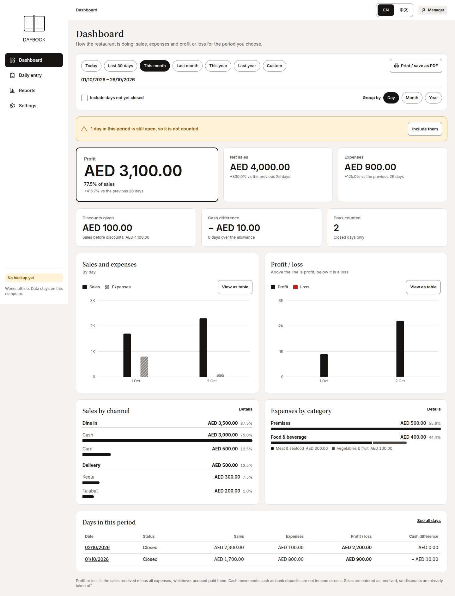
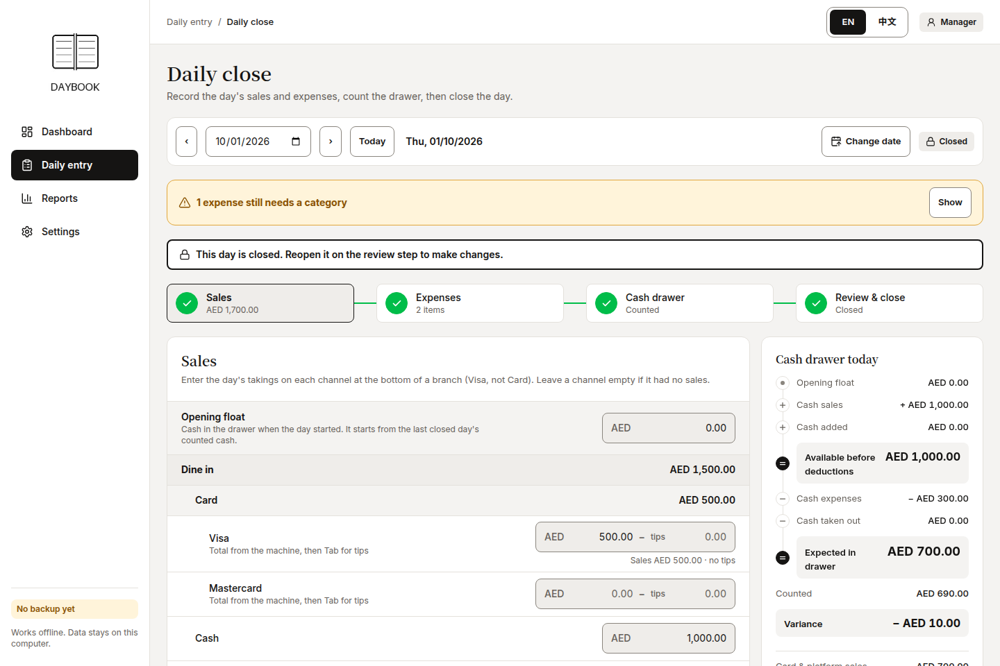
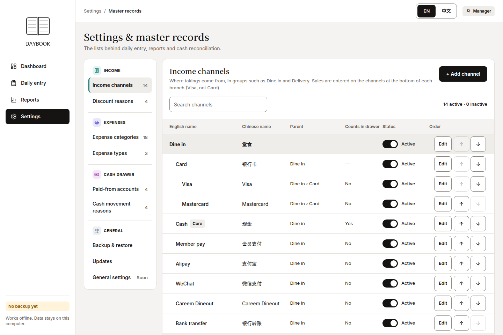
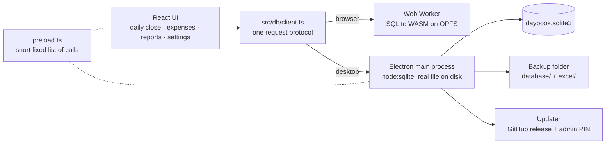

# Offline-First Desktop Accounting for a Restaurant

> A bilingual (EN / 简体中文) desktop app for a restaurant's daily close, expenses, cash reconciliation and reports. It runs fully offline on the counter PC, keeps its data in one SQLite file, backs itself up automatically, and updates itself only when the manager approves with a PIN.

**Type:** Client project for a restaurant business (name withheld)
**Role:** Sole developer: discovery with the manager, product design, architecture, UI, tests, release pipeline
**Period:** 26 October to 3 November 2026 (from the project's commit history), version 0.1.9. The browser demo came first and the desktop app two days later.

| Dashboard: closed days only, figures checked by hand | Daily close: a closed day with the drawer count | Bilingual master records |
|---|---|---|
|  |  |  |

*Screenshots are from the browser build with sample data; the [Chinese dashboard](screenshots/04-dashboard-zh.png) shows the same page in 简体中文.*

**Code:** The real application source is in [`app/`](app), published by its author with the owner's permission. Only the client's name, logo and artwork were removed. See [What was changed](#what-was-changed-for-publication).

## Problem / Context

The restaurant was a young business, a startup a couple of years ago. It began with a conversation with the manager: she wanted a system to see **profit and loss**, and to look into **expenses and drill down** into them. Before writing anything I studied how the restaurant actually ran its day, because that is where the real problem was.

### How the day was handled before

- The restaurant earns through **several channels** (dine-in, card, delivery platforms and others). The POS/order system gave no useful end-of-day report: it could only print a sales summary onto a billing slip.
- So the cashier checked the **delivery platforms' own dashboards** (Talabat, Keeta and others) for each channel's income, added the totals up **on a calculator**, and wrote them down.
- The cashier also wrote down **what was added to and taken out of the drawer**. Expenses were normally paid out of the drawer's own takings, so the drawer balance only made sense if every one of those movements was recorded.
- Every **daily expense** was written down as well. The expense and income receipts were then handed to an **outside accounting firm** for the books.

The result: everything was manual calculation and manual drawer balancing, and none of it could answer the manager's question about profit and loss.

### What I decided to build

The manager asked for a report viewer. Having seen the process, I decided the system had to be **more than a report viewer**: if the figures are typed in once, at the counter, in the same order the cashier already works, the reports come for free and the drawer balances itself. So the first version was:

1. **An entry system** for the day's income, expenses and cash movements, following the cashier's own routine: sales by channel, expenses, drawer count, review and close.
2. **A daily report that works two ways:** understandable at a glance (a dashboard), and detailed enough for the accountants who receive the receipts.
3. **Profit and loss with expense drill-down**, which was the original ask.

I planned to demonstrate this as an **MVP first** and learn the real reporting requirements and adjustments from the manager's feedback, rather than guess them upfront.

### Requirements that followed

- **Fully offline, data stays local.** The manager did not want the system online or connected to the internet. The sidebar says so in plain words.
- **Bilingual, not translated afterwards.** English and 简体中文, switchable from the top bar, with an English *and* a Chinese name stored on every master record and both always visible.
- **Money that matches their sheets.** Totals reproduce the restaurant's own figures to the cent, hence integer fils.
- **A counter-friendly UI.** Monochrome and calm, WCAG AA contrast, 44 px touch targets and 56 px table rows, usable down to a small POS screen.
- **Reports people can take away:** Excel exports and printed or PDF reports.

### What changed along the way

- **Future branches.** After the first conversations the manager said the restaurant would add branches later. I kept the offline-only rule but did not close the door on an internet-first system: the stack document lays out a path (browser demo, desktop install, central server) and the first design rule was to keep each later step cheap, with a relational schema, integer money, and every database call behind one module.
- **Further adjustments.** The manager kept asking for changes, which turned a one-off install into a release problem (see below).

## Why a browser build *and* a desktop app, and a release system

| Date | What happened |
|---|---|
| 26 Oct | Settings, daily close, dashboard and reports built as a **browser-only demo**: React, with SQLite compiled to WebAssembly in a Web Worker and stored in the browser's private storage. |
| 28 Oct | A **recovery report** lists what can go wrong when all the figures sit in one file on one PC. In the same two days: backup and restore, daily Excel copies, then the **Electron desktop app**. |
| 2 to 3 Nov | Self-update with an admin PIN, backup retention, a safe start when data can't be opened, card tips, and PDF reports with a cover page. |

- **Browser first, because it is fast to build and to demonstrate.** A browser build is a static folder that can be shown or installed on any machine with nothing to set up. It needs `localhost` or HTTPS, and only one tab can hold the database. That was enough to put real screens in front of the manager and collect feedback.
- **Then an Electron wrapper, because the manager wanted no internet and a browser is the wrong home for the only copy of a business's figures.** The recovery report names the browser-only risks: someone clears browsing data, a "PC cleaner" runs, the browser profile is reset, or the browser evicts storage when the disk is low. Each one is a *total loss*, and the database is invisible in the file explorer so it can't be copied or put on a USB drive. I replaced the browser's SQLite-in-WebAssembly with native SQLite in the Electron process, so the data is a real file. "Desktop app" is the first of the report's eight must-haves before real use.
- **The move was cheap because of the first design rule.** The Electron app runs the same React code, the same migrations, the same backup checks and the same request protocol. Only where the database lives changes, and a browser demo's data can be moved across by restoring its backup file.
- **Backup and restore, because this may become the source of truth.** Once the system replaces the manual books, and with more branches later, losing the file means losing the business's records. So I worked through the failures that could happen (disk death, theft, cleared data, a bad update, a corrupt file, backups that silently stopped) and built the backups, restore and recovery screens around that list.
- **A git-based release and upgrade system, because the manager kept asking for changes.** Redeploying by hand to the counter PC after every request does not scale. Now a version tag builds the installers in CI, and the app checks for the new version itself; the manager installs it with an admin PIN, after an automatic backup.
- **The browser build stayed, in a smaller role.** It is the fast development loop, the target of the 88 browser end-to-end tests, and a way to show the product with no install.
- **The central server stayed on paper.** It would give real-time reports across branches but needs a server and internet. Nothing in the repo implements it, so one PC is the master and there is no multi-counter sync. That is a deliberate limit for now.
- **Electron over Tauri.** The recovery report judged them equal for backups (Tauri is smaller, Electron has more mature tools and more developers). I chose Electron.

## Approach & Architecture

The page code is one React app. Where the data lives is the only thing that differs between the browser build (used for the first demo) and the Electron desktop app (used at the counter).

- **One protocol, two engines.** `src/db/protocol.ts` defines the requests; `src/db/client.ts` sends them to a worker in the browser or over IPC to the main process in the desktop app. The same migrations (`src/db/migrations.ts`) and the same backup-checking rules (`src/db/describe.ts`) run on both sides.
- **The page is sandboxed.** It cannot touch the file system. `electron/preload.ts` exposes a short, fixed list of calls, file writes are limited to the `database/` and `excel/` subfolders of the chosen backup folder, and the window cannot navigate to other websites.
- **Reports from the same data.** Dashboard and report tabs are SQL over the same file, exported to Excel (ExcelJS, with styled sheets) and printed or saved as a PDF with a cover page and a contents page with page numbers.
- **Nothing to install on the PC.** The main process uses only Node built-ins (`node:sqlite`), so the installer ships no `node_modules`.

## Key Decisions & Tradeoffs

| Decision | Why | Tradeoff |
|---|---|---|
| **One codebase, browser demo first, Electron second** | The demo put real screens in front of the manager quickly, and the desktop app followed in two days because storage, not UI, was the only thing that changed | The browser build can't be the production target: it holds only its own device's data, with the loss risks above |
| **Money is integer fils**, never floats (`src/lib/money.ts`) | Totals must match the owner's sheets to the cent, and sums of floats drift | Every input and display goes through `parseFils` / `formatFils` |
| **SQLite as a single file, every save one transaction** | A power cut during a save rolls back cleanly instead of leaving half an entry. The file is readable by free tools if the developer is ever unavailable | One PC is the master. There is no multi-counter sync |
| **Migrations are append-only and transactional.** A plain copy of the file is saved to `before-upgrade/` first (newest 5 kept) | A failed upgrade leaves the data exactly as it was. Data written by a *newer* version is refused, never opened for writing | Old steps can never be edited, only followed by new ones |
| **Three automatic backups**: on demand, at day close, on every app close. Each is read back and checked before older ones are deleted | The biggest risk is nobody remembering to back up, and then finding the backups never worked | More files on disk, so retention was needed |
| **Retention like log rotation** (`src/features/backup/retention.ts`): all for 14 days, then daily, weekly, monthly. Floors can't be lowered below safe minimums, the newest 10 are always kept, and changing the rules needs the admin PIN | An unbounded backup folder grows to roughly 8 to 10 GB in two years. A wrong PC clock or a mistaken setting must not wipe history | Policy code is pure (no file access) so it is easy to test, at the cost of a second layer that does the deleting |
| **Updates from public GitHub releases, installed only with an admin PIN.** Only a salted scrypt hash of the PIN ships; five wrong tries lock it for 15 minutes, surviving restarts; the approval lives in the main process for 10 minutes | The code can stay in a private repo and the PC needs no token, but a cashier can't install a new version mid-service | The installer is unsigned, so SmartScreen warns on the first manual install. Updates after that are silent |
| **Backup before every update**, and a safe-start screen when data can't be opened | An update is the most likely moment to lose data, so the install path always has a restore point | A slightly slower "Back up and restart" |
| **Bilingual by construction.** Every master record has an EN and a ZH name; a test checks the two translation files have identical keys | The second language never silently falls behind | Some strings are written twice |

## Measured Impact

**The outcome for the restaurant** (as reported by the manager, not a measured figure): for the first time they could easily understand a whole month's income and expenses, September's, in one place, and with the expense breakdown they could see which costs they needed to be more careful about. That is the profit-and-loss and expense drill-down she originally asked for. I have no time-saved figures or user counts, so none are quoted.

**What is verified from the repository:**

- **50 unit tests** (7 files, Vitest): money, period and report maths, retention rules, migrations on realistic data, the admin PIN lockout, and translation-key parity.
- **88 Playwright browser end-to-end tests** and **8 Electron end-to-end tests**: data survives a restart, backups are written and restore, an upgrade that fails leaves data untouched, newer-version data is refused, the PIN gates updates, retention thins old backups, and the PDF report contains the cover and every section.
- **Released through the full pipeline**: a version tag builds the Windows installer and a Linux AppImage in CI. The pipeline was built and iterated on across versions 0.1.4 to 0.1.9 (the commit history includes a "first update test" at 0.1.6).
- **About 11,800 lines of TypeScript**, tests included, across the UI, database layer and Electron process.

## Tech Stack

TypeScript · React 18 · Vite · Tailwind CSS 4 · SQLite (`@sqlite.org/sqlite-wasm` in a Web Worker, `node:sqlite` in Electron) · Electron · electron-builder + electron-updater · React Hook Form + Zod · i18next · Recharts · ExcelJS · Vitest · Playwright · GitHub Actions.

## Run it

Install, run, test and packaging commands, the request/backup flow diagram and a code tour are in [`app/README.md`](app/README.md). Start with the code tour; it takes about ten minutes.

**Look at first:** `app/src/features/backup/retention.ts` (with `retention.test.ts` beside it) is the fastest proof of the data-safety thinking: a pure, testable policy with hard floors, that decides what a backup folder keeps. Then `app/src/db/client.ts`, which shows how one request protocol serves both the browser and the desktop app.

## Lessons learned

- **Build with the customer, in real time, and get something in front of them early.** I worked with the manager's feedback as the system took shape, and introduced it quickly rather than after a long build. Getting a working version in front of her in a short time gave a good first impression, and that goodwill carried through the later change requests. Watching the real process first, instead of building only the report viewer she asked for, is what made the first version fit.
- **Turning a web app into a desktop app, with backup and restore, was new to me, and this project is where I learned it.** I had no earlier experience of it. Keeping the web version and wrapping it in Electron with native SQLite worked because the database calls were already behind one module. Thinking through how the system could fail, and building backups, restore and recovery around that list, came from treating the app as a possible single source of truth for the business.

## What was changed for publication

- **Renamed.** The product is called "Daybook" here. The client's name, its parent company, the release repository, the app ID and the seal on the report cover were replaced.
- **Brand assets replaced.** The logo, report-cover painting and app icon are placeholders drawn by [`app/tools/make_placeholders.py`](app/tools/make_placeholders.py).
- **Internal documents left out**: the client's requirements brief and its risk and recovery plan. The recovery *design* is kept in `app/docs/desktop-app.md`.
- **No git history or screenshots from the original repository** are included.
- The seed data (channels, categories) is sample data. The currency is configured as AED.
- The updater is wired to a placeholder releases repo (`example-org/daybook-releases`), and `DAYBOOK_ADMIN_PIN` is not set, so local builds can't install updates.
