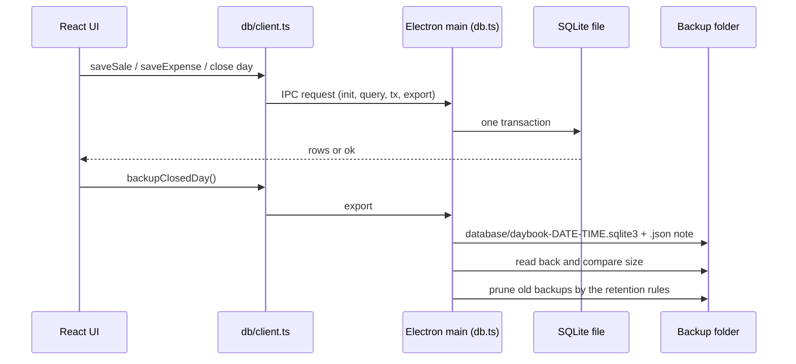

# Daybook: the application source

The runnable app behind the [Offline-First Desktop Accounting case study](../README.md). Read that first for the problem, the decisions and the impact.

This is **real application source**, not a clean-room sample: it was built for a restaurant business and is published by its author with the owner's permission. The client's name, logo, artwork and internal documents were removed and replaced (see [What was changed for publication](../README.md#what-was-changed-for-publication)). Seed data is sample data.

## Prerequisites

- Node 24 (what the CI release workflow uses) and npm.
- For the desktop app: nothing else on Linux or Windows. Building the Windows installer (`dist:win`) is meant to run on Windows, or on Linux with Wine.
- Optional: Python 3 with Pillow, only to regenerate the placeholder brand assets (`python3 tools/make_placeholders.py`).

## Run it

```bash
npm ci
npm run dev                  # browser version at http://localhost:5173 (data in the browser's private storage)
npm run electron:build       # builds dist/ and dist-electron/
npm run electron:start       # desktop app; data in ~/.config/Daybook/daybook.sqlite3 (%APPDATA%\Daybook on Windows)
npm run electron:dev         # desktop app against the dev server (run `npm run dev` first)
npm run dist:linux           # AppImage in release/
npm run dist:win             # Windows installer in release/
```

Environment variables for development: `DAYBOOK_USER_DATA` (data folder), `DAYBOOK_NO_UPDATE=1` (switch updates off), `DAYBOOK_SPLASH_MS=0` (skip the splash wait), `DAYBOOK_DEFAULT_BACKUPS` (backup folder). A local build has no admin PIN, so it can never install an update.

## Tests

```bash
npm run typecheck            # page + Electron main process
npm test                     # 50 unit tests (Vitest)
npm run e2e                  # 88 browser tests (Playwright starts the dev server itself)
npm run electron:build && npm run e2e:electron   # 8 desktop tests
```

Unit tests cover money, period and report maths, retention, migrations on realistic data, the admin PIN lockout, and EN/ZH key parity. The e2e tests drive the real UI: closing a day, expenses, discounts, tips, reports, backup and restore, responsive layouts. The Electron tests cover restart persistence, backups on close, failed upgrades, newer-version data, PIN-gated updates, retention and PDF export.

## How a request and a backup flow



In the browser the same `Request` messages go to a Web Worker (`src/db/worker.ts`) instead of IPC.

## Code tour

Read in this order:

1. `src/db/protocol.ts`: the request/response contract every database call goes through, plus the `BackupInfo` a backup is checked against.
2. `src/db/client.ts`: picks the worker or the Electron bridge, so the rest of the app doesn't care where data lives.
3. `src/db/migrations.ts`: append-only, one transaction per step, tracked by `PRAGMA user_version`.
4. `src/lib/money.ts`: integer-fils parsing and formatting, the base of every total.
5. `src/features/backup/retention.ts`: the pure retention rules, with `retention.test.ts` beside it.
6. `electron/main.ts`, `electron/adminPin.ts`, `electron/updater.ts`: the backup-on-close path, the salted-scrypt PIN with lockout, and the PIN-gated update flow.

Packaging, updates, retention and recovery are documented in [`docs/desktop-app.md`](docs/desktop-app.md).
